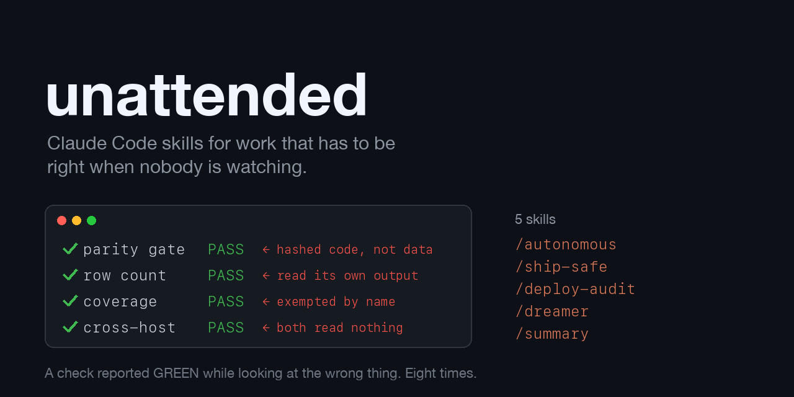
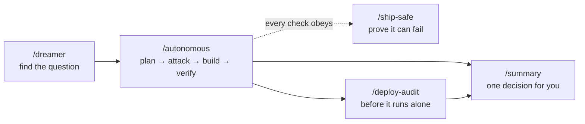

<p align="center">
  
</p>

# unattended

**Five Claude Code skills for work that has to be right when nobody is watching.** Let Claude run a
multi-step job on its own, check its work properly, audit a system before it goes live, explore data
without fooling itself, and report back in a shape you can act on in 30 seconds.

[](https://github.com/sethimadhav10/unattended/actions/workflows/test.yml)


```text
/plugin marketplace add sethimadhav10/unattended
/plugin install unattended@unattended
```

---

## Why these exist

These skills came out of months of running live, unattended systems with Claude Code: nightly data
pipelines, scheduled jobs, things with real money downstream. The bugs that hurt were never the
loud ones. They were the ones where **every check passed**.

> **A check reported GREEN while looking at the wrong thing.**
> Not wrong logic. Wrong *object*. Every instance passed its own test.

The same failure, eight times:

1. A parity gate hashed the code and the model, never the data. Identical hash, hollowed inputs, three months.
2. A coverage gate measured the right number and was exempted by name in writing. Nobody came back.
3. A completeness check read the file it had just written. `rows == n` held by construction.
4. Documents landed in a directory the parser did not glob. The crawl exited green on nothing.
5. A cross-host consistency gate passed because both hosts read the same missing data. Agreement on garbage.
6. A permanent billing failure was classified as a transient token error and retried 5,334 times.
7. A fix printed `adjusted N rows` while every consumer read a stale reference to the pre-fix data.
8. A verification asserted on the source column. The model read a *derived* column, where the null had already become a zero.

Code review doesn't catch these: the code is fine. You catch them with process. Every rule in these skills
was earned by a defect that shipped past someone competent.

## The skills

| Skill | What it does | Use it when |
|---|---|---|
| **[`/autonomous`](skills/autonomous/SKILL.md)** | Six agents: two plan blind, one merges and builds, one attacks, one verifies against **sealed** acceptance criteria, one judge decides only "does this need the human?" You get interrupted once. | You hand over a multi-step change and want it done right without babysitting it |
| **[`/ship-safe`](skills/ship-safe/SKILL.md)** | The rules that catch a check passing on the wrong object: assert where the value is *consumed*, call the real code, prove every check can fail, verify the defect exists *in that source* before repairing it | Before you believe a PASS, and before anything irreversible |
| **[`/deploy-audit`](skills/deploy-audit/SKILL.md)** | Four parallel read-only auditors (live flow, inventory, dependencies, adversarial) → execution map, ownership table, ranked risks with `file:line`, rollback path | Something goes from "it works" to "it runs by itself" |
| **[`/dreamer`](skills/dreamer/SKILL.md)** | Hypothesis-free data prospecting in a sealed sandbox: slice, pivot, sort by the metric that matters, chase what screams. Writes *threads*, never verdicts, for a later skeptic | You want to find the question, not test an answer |
| **[`/summary`](skills/summary/SKILL.md)** | A fixed-heading brief: what's settled, **exactly one** decision for you, each stream, decisions coming later, ETA. Every claim tagged ✔ verified · ◐ reported · ? assumed | Coming back to a long session, or after agents report |

## How they fit together



Each skill works on its own. Together they cover the whole path: explore, change, verify, go live, report.

## Ideas worth stealing even if you never install this

- **Seal the acceptance criteria before you build.** Hash the document; the verifier refuses to run if
  it moved. Otherwise a disappointing result invites "one more lap" until the harness agrees with a
  wrong answer.
- **Run the criteria against the *unchanged* system first.** Every "the world is like this now"
  assertion must be green at t=0. One sealed criterion demanded two hosts be byte-identical; they
  differed by a timestamp line *before anything was built*.
- **Run the planted-defect arms before sealing too.** One batch sealed 45 criteria; five of its
  "this check can fail" demonstrations were measured to be *incapable* of failing. A check that has
  never fired and one that cannot fire look identical on paper.
- **Merging is a list comparison, not a review.** When an agent merges several plans, make it publish
  one row per source item: kept, merged into, or dropped (with a reason). Absence is invisible to
  reviewers reading the merged result.
- **The verifier never sees the builder's story.** It gets the criteria and the artefacts. Otherwise it
  grades the narrative.
- **The claim you make right after a big retraction is the least-scrutinised one in the room.**

## Install

**As a plugin (recommended):**

```text
/plugin marketplace add sethimadhav10/unattended
/plugin install unattended@unattended
```

Plugin skills are namespaced (`/unattended:autonomous`, …). Claude also picks them up on its own when
the task matches.

**Manual install** (plain `/autonomous`, `/summary`, …):

```bash
git clone https://github.com/sethimadhav10/unattended && cd unattended && ./install.sh
```

It copies the five skills into `~/.claude/skills`, never overwrites a skill of the same name that it
didn't put there, and `./uninstall.sh` removes only its own.

## What's honest to say about it

- These are **process skills**: Markdown instructions, no code runs. They make Claude slower and more
  careful on purpose. Don't use `/autonomous` for a one-line fix.
- `/autonomous` spawns six agents and loops up to twice per stage. On a big task that is a lot of
  tokens. It is built for changes where a silent wrong answer costs more than the tokens.
- The failure catalogue is real, from one programme of live systems. It has been anonymised. None of
  this has been benchmarked.

## Companion

**[preclear](https://github.com/sethimadhav10/preclear)**: stop `/compact` from forgetting. Claude
keeps its own working-memory file, and `/preclear` → `/clear` reloads exactly what it chose to keep.
Long unattended runs need both.

## Files

```text
.claude-plugin/plugin.json        plugin manifest
.claude-plugin/marketplace.json   lets `/plugin marketplace add sethimadhav10/unattended` work
skills/<name>/SKILL.md            the five skills
install.sh / uninstall.sh         manual install without the plugin system
tests/test_skills.py              frontmatter, manifests, install round-trip
```

MIT licensed. Issues and PRs welcome, especially new entries for the failure catalogue: a check that
passed while looking at the wrong thing, and the rule that would have caught it.

<sub>Keywords: Claude Code skills, Claude Code plugin, autonomous coding agent, multi-agent
verification, AI agent guardrails, acceptance criteria, test the tests, mutation testing mindset,
production readiness review, deploy checklist, silent failures, data exploration, exploratory data
analysis, status report template, agent orchestration.</sub>
